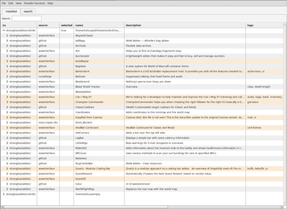
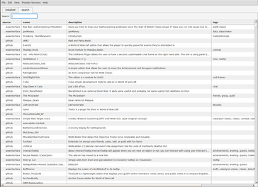

# Strongbox 8, a World of Warcraft addon manager

This is a rewrite of [Strongbox](https://github.com/ogri-la/strongbox) in [Go](https://go.dev) and [Tcl/TK](https://www.tcl-lang.org) and __is not stable, is not feature complete__ and  __is not safe to use in parallel with Strongbox 7__.

This repository __will be squashed and merged into regular [Strongbox](https://github.com/ogri-la/strongbox)__ once it exits alpha.

It runs on Linux and _Windows_ (**not** Mac, see [Major Version Changes](#major-version-changes)).

It supports addons hosted by [wowinterface.com](https://wowinterface.com), Github and Gitlab.

[Issues](./issues) and [Discussion](./discussions) are welcome. No code contributions, thank you.

[](./screenshots/screenshot-8.0.0-alpha.3-installed.png?raw=true)
[](./screenshots/screenshot-8.0.0-alpha.3-search.png?raw=true)

## Installation

Binaries for supported platforms are available from the [releases page](https://github.com/ogri-la/strongbox8/releases).

Prerequisites for all binaries _except_ the `.AppImage`:

* `tcl`
* `tk`

Linux binaries also require these X11 libraries (you probably already have them):

* `libXcomposite`
* `libXdamage`
* `libXfixes`

If not, Arch:

    pacman -S tcl tk libxcomposite libxdamage libxfixes

Or Debian:

    apt install tcl tk libxcomposite1 libxdamage1 libxfixes3

## Building

Prerequisites for building yourself:

* `build-essential`
* `tcl`
* `tcl-dev`
* `tk`
* `tk-dev`
* `libxcomposite-dev`
* `libxdamage-dev`
* `libxext-dev`
* `libxfixes-dev`

Then:

```shell
git clone https://github.com/ogri-la/strongbox8
cd strongbox8
./manage.sh clean # clones my fork of `visualfc/atk`, a Go tcl/tk wrapper
./manage.sh build
```

There is a [Dockerfile](https://github.com/ogri-la/strongbox8/blob/master/Dockerfile) for building binaries across 
architectures that may help. It can be built with:

```shell
./manage.sh build.image
```

## Major version changes

* Clojure replaced with Go, JavaFX replaced with Tcl/TK
* Mac support is dropped in favour of Windows
    - In order to compile for Mac I need macOS SDK headers that are only available if I agree to the XCode developer T&C's.
    - I'm not confident the resulting binary will be compatible with the GPL, but there _is_ a GPL 'System Library exception' that should be investigated.
    - apps that are not notarised by Apple's Gatekeeper are blocked unless hoops are jumped through
    - I don't own a Mac and given Apple's lameness, I don't really want one. Sorry guys, git gud.
* To run the binaries you will need Tcl/Tk installed, just like you needed Java to run the .jar files
* The `.AppImage` will continue to be the most convenient standalone binary for linux-amd64

## Pros/Cons

Benefits of Strongbox 8:

* faster startup and a huge amount of room for speed improvements
* greater confidence during development because of static typing and analysis
* smaller, native binaries
* clearer addon data model
* shed a lot of baggage

Drawbacks of Strongbox 8.0

* shed a lot of baggage. Baggage is not bad! Strongbox 7.0 is hardened by experience with a comprehensive test suite.
* Tcl/Tk for the GUI. Love it or hate (I love it), it doesn't look 'modern' but it should feel more 'native'.
* code is definitely more verbose, but that is the Go way and I don't mind.
* Strongbox is now a module of a larger system so the interface will be less specific to addon management and more general.

## Second System Syndrome

I've rewritten Strongbox from Clojure and JavaFX into Go and Tcl/Tk. Clojure is still amazing, but:

I had designed myself into a corner by Strongbox 7.

Small changes were having large effects and I wanted to be making large changes.

I wasn't confident I could keep all the complexity in my head while developing.

The time I have available to develop are a few hours on evenings and weekends and even finding that time is rare.

My enthusiasm for debugging run time errors and data problems was evaporating.

Java and Clojure are fast but Clojure's start up time is slooow.

Data structures I was working with had become a soupy mess.

`clojure.spec` and [Orchestra](https://github.com/jeaye/orchestra) are super powerful and were keeping me sane but they are slow during development and turned off outside of development. They aren't helpful at compile time.

The GUI was JavaFX and developed with the (often incomprehensibly) clever [cljfx](https://github.com/cljfx/cljfx). It felt like a black box between me and JavaFX. When I did manage to break through it I then had to contend with JavaFX, which is ... well, obtuse.

I do not use the REPL for development, I hate the idea of keeping all of that dirty state in my head and it underminding assumptions later. This makes me a poor Lisper `;)`

I've finally developed an allergic reaction to clever code.

Clojure, for this small project, had become an impediment to dipping into development and to long term maintenance.

I have another project that loosely ties together 'providers' of 'services' in to a sort of 'data browser' that Strongbox is now helping to propel forwards. This is a classic [Second System Syndrome](https://en.wikipedia.org/wiki/Second-system_effect) and I'm not sorry `;)`

I'm enjoying translating Clojure to Go. Getting the base system off the ground has been a faff and there is loads more to come, but I'm feeling it gel now and I'm able to re-model some of the lousiest aspects of Strongbox 7.0 - the data model especially.

## AI

I _love_ AI. I am a high priest in the cathedral of vibes and an unashamed purveyor of slop. After a _lifetime_ of writing code and endlessly struggling to realise my ideas, I am now free to focus on the project's intent rather than it's implementation.

If you feel strongly that code should be pure hand crafted artisanal opcodes, that that is somehow _better_, more _authentic_, then please just abstain.

 I am a creative and technical person and the software I build now is much more consistently executed and realised than I could ever have fathomed just a year or two ago. My frustrations are less, my expectations are higher and I have more time to focus on the aspects of these projects that please me most.

 Strongbox v8 is suffering because of all of the other projects I have going on right now. It is pre-AI code that is being completed using AI. My choice of Tcl/Tk is a fun constraint because it is _ancient_ and extremely programmable. If I were to start over today it would no doubt be some blobby html/js based app. Instead I persevere with my pre-AI decisions.
 
 Strongbox v7 and v8 only continue to exist _because_ of AI.

## License

Copyright © 2025 Torkus

Distributed under the GNU Affero General Public Licence, version 3
